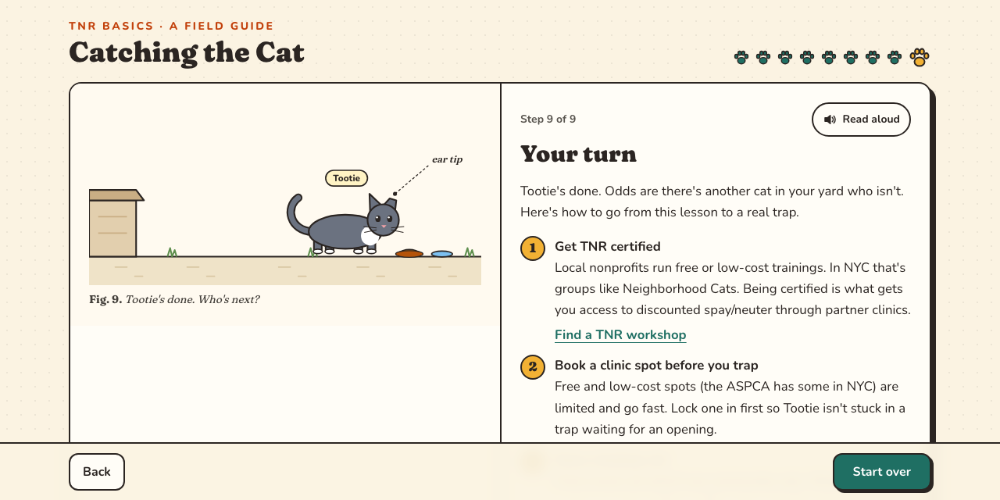
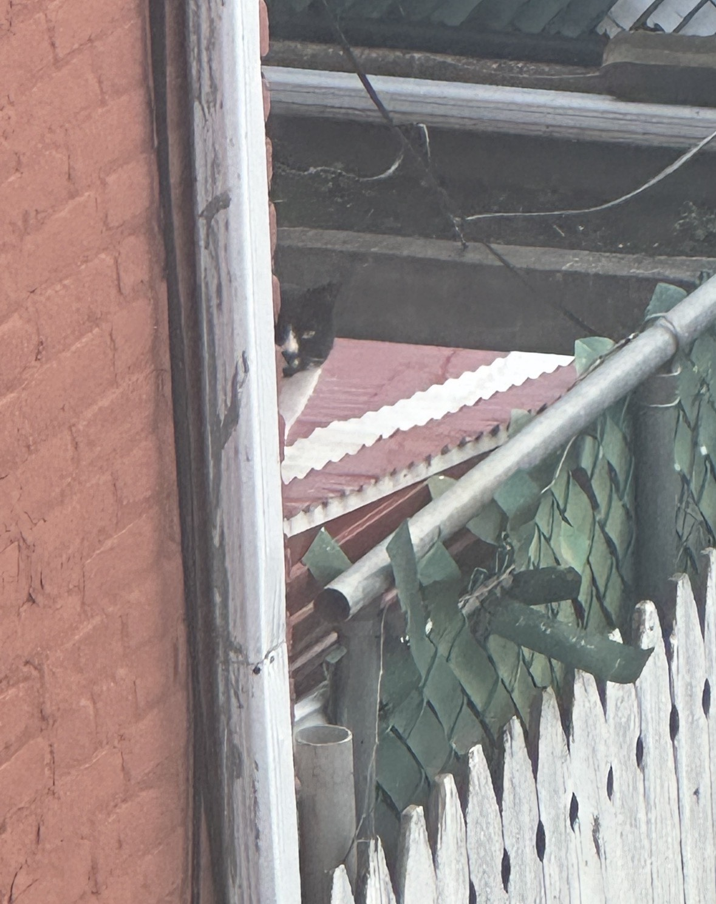

# TNR Basics: Catching the Cat

This is an interactive field guide for all ages that teaches folks how to humanely trap a community cat for TNR (trap, neuter, return). I based this off of my own experience doing TNR in New York City. In this interactive experience you meet Tootie, learn how a box trap works, how to bait it, set it, handle the moment the door drops, and finish with what to do in the real world.

**Live:** https://tnr-tootie.vercel.app/
**Repo:** https://github.com/sophieadamsweb/tnr-tootie



## Run it locally

```bash
npm install
npm run dev      # http://localhost:3000
npm test         # content + logic tests
npm run build    # production build
```

## Time and tools

- **Time spent:** about 4 hours. Roughly 1 hour building the prototype, 1 hour getting everything working with Claude Code, and the rest on the flourishes (the field guide styling, drawing Tootie, the sardine cursor, the SNAP, the ear-tip ending), plus testing and deploying.
- **Stack:** the provided Next.js 16 + React 19 + TypeScript + Tailwind v4 starter.
- **Added libraries:** `@fontsource-variable/fraunces` and `@fontsource-variable/nunito` (fonts, bundled so nothing loads from Google), and `vitest` (tests). That's it.
- **Code notes:** every function and major block has a short comment on what it does and why. [NOTES.md](NOTES.md) walks through the files in order.
- **AI use:** I used Claude to talk through the lesson flow, scaffold the components from my first draft, audit some copy, and run QA. I pulled the TNR content from my own experience, made the design and teaching decisions, and reviewed and edited all of the code.

## Tradeoffs

- **Free placement over multiple choice.** Dropping the food anywhere is a real decision instead of picking from three answers. It doesn't work without a pointer, so the same spots are also buttons.
- **Single page, local state.** No routing, no persistence, no state library. Reloading starts you over.
- **Boring on purpose.** Plain `if` statements, one component per file, a comment on everything.
- **Light theme only.** A warm paper palette fit the field guide idea better than dark mode in the time I had.

## With more time

- Play out the wrong bait spots: Tootie grabs the food by the door and strolls off.
- Save progress and let you jump back to finished steps from the paw prints.
- Test with real screen reader users and people who've never trapped before.

## Known limitations

- The trap drawing is simplified and not to scale.
- Read aloud sounds different everywhere, since it uses your browser's voices.
- The "Your turn" resources are NYC-heavy because that's where I trap.

## More detail

The long version lives in [docs/DESIGN.md](docs/DESIGN.md): why this topic, the step-by-step lesson, how it teaches, project structure, how it works, accessibility and testing.

## The legendary Tootie

